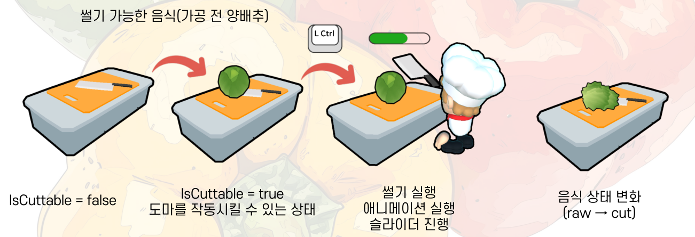
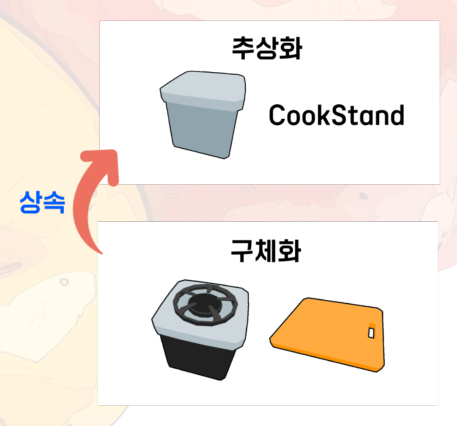
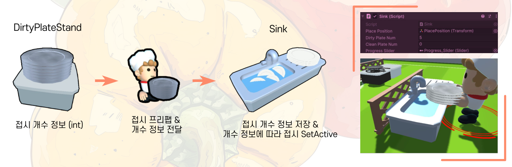

# Kitchen Kingdom: 정수빈 담당 작업

프로젝트 개요와 팀 구성은 [README](./README.md)에서 확인할 수 있습니다.

첨부 이미지는 팀 프로젝트 발표 자료에서 발췌했습니다.

---

## 담당 코드

| 기능 | 관련 파일 | 기여도 |
| --- | --- | --- |
| 설거지 시스템 | [Sink.cs](./Assets/02.Scripts/Object/Stand/Sink.cs) | 주 담당 |
| 더러운 접시 생성 및 거치 | [DirtyPlateStand.cs](./Assets/02.Scripts/Object/Stand/DirtyPlateStand.cs), [DirtyPlate.cs](./Assets/02.Scripts/Object/DirtyPlate.cs) | 주 담당 |
| 재료 손질 | [ChoppingBoard.cs](./Assets/02.Scripts/Object/ChoppingBoard.cs), [OnChoppingBoard_Collider.cs](./Assets/02.Scripts/Object/OnChoppingBoard_Collider.cs) | 주 담당 |
| 조리대 공통 구조 | [CookStand.cs](./Assets/02.Scripts/Object/CookStand.cs) | 주 담당 |
| 결과 및 엔딩 | [ResultSceneManager.cs](./Assets/02.Scripts/Manager/ResultSceneManager.cs), [FinalResultSceneManager.cs](./Assets/02.Scripts/Manager/FinalResultSceneManager.cs), [EndingSceneManager.cs](./Assets/02.Scripts/Manager/EndingSceneManager.cs) | 주 담당 |
| 씬 관리 및 플레이어 생성 초기 구현 | [SceneNames.cs](./Assets/02.Scripts/Scene/SceneNames.cs), [MainScene_1.cs](./Assets/02.Scripts/Scene/MainScene_1.cs) | 주 담당 |
| 스테이지 구성 | Stage_1~4_Beta.unity ([01.Scenes 폴더](./Assets/01.Scenes)) | 주 담당 |
| 플레이어 이동 및 잡기 | [CharacterMoveAbility.cs](./Assets/02.Scripts/Character/CharacterMoveAbility.cs), [CharacterHoldAbility.cs](./Assets/02.Scripts/Character/CharacterHoldAbility.cs) | 공동 |
| 게임 매니저 및 음식 오브젝트 | [GameManager.cs](./Assets/02.Scripts/Manager/GameManager.cs), [FoodObject.cs](./Assets/02.Scripts/Object/FoodObject.cs) | 공동 |
| 소화기 초기 구현 | [Extinguisher.cs](./Assets/02.Scripts/Object/Extinguisher.cs) | 공동 |

스테이지 구성은 팀원이 제작한 레벨 디자인 맵을 적용하고, 스테이지별 재료 및 접시 배치, 라이팅, 팀원 작업의 씬 통합을 담당했습니다.

---

## 주요 구현 자료

### 재료 손질 시스템

### 조리대 공통 구조

---

## 문제와 해결 1: 공용 싱크대의 상태 동기화

> 고정된 공용 오브젝트는 소유권을 옮기지 않고, 바뀐 값만 RPC로 전달했습니다.

### 문제

싱크대는 여러 플레이어가 함께 사용하는 오브젝트이므로, 한 플레이어가 조작한 결과가 다른 클라이언트에서도 동일하게 보여야 했습니다.

플레이어가 들고 옮기는 오브젝트에는 팀원과 논의하여 플레이어에게 소유권을 이전하는 방식을 적용했습니다. 해당 소유권 이전 코드는 팀원이 구현했습니다.

하지만 싱크대는 제자리에 고정되어 여러 플레이어가 번갈아 사용하는 오브젝트이기 때문에, 동일한 방식을 사용하면 조작할 때마다 소유권을 이전해야 했습니다.

### 해결

- 싱크대의 소유권을 고정하고, `_nearbyCharacter.PhotonView.IsMine`을 통해 로컬에서 제어하는 캐릭터인지 확인했습니다.
- `RpcTarget.AllBuffered`를 사용해 세척 여부, 세척 진행도, 더러운 접시와 깨끗한 접시 수를 동기화했습니다.
- 깨끗한 접시를 꺼낼 때는 `RequestSpawnPlateOnHand`를 통해 MasterClient에 생성을 요청했습니다.
- MasterClient에서 `InstantiateRoomObject`로 접시를 생성하여 생성 요청자가 퇴장해도 접시가 함께 제거되지 않도록 구성했습니다.

### 기술 선택 이유

돌아보면, 이동 가능한 오브젝트는 플레이어가 들고 있는 동안 위치와 상태가 계속 변경되지만, 싱크대는 위치가 고정되어 있고 접시 수와 세척 진행도 등의 값만 변경됩니다.

따라서 싱크대에는 소유권을 이전하는 대신 RPC로 상태 변경을 전달하는 방식이 적합했습니다.

### 관련 코드

- [Sink.cs](./Assets/02.Scripts/Object/Stand/Sink.cs)

### 개선 검토(미적용)

- 세척 진행도를 매 프레임 `RpcTarget.AllBuffered`로 전송하고 있어, RPC 버퍼가 계속 쌓이고 나중에 입장한 플레이어가 이를 모두 재실행하게 됩니다. 진행도는 버퍼링하지 않는 RPC나 `OnPhotonSerializeView`로 동기화하고, 시작과 완료 같은 상태 변화만 버퍼링하는 방식이 적합합니다.
- 세척을 중단했을 때 진행도를 저장하는 `savedProgress`가 로컬 변수로 관리되고 있습니다. 다른 플레이어가 세척을 이어받으면 기존 진행도가 유지되지 않을 가능성이 있으므로, 개선 시 저장된 진행도도 동기화 대상에 포함하는 것을 고려할 수 있습니다.

---

## 문제와 해결 2: ViewID를 활용한 네트워크 오브젝트 참조

> RPC로 넘길 수 없는 객체 대신 ViewID(int)를 넘기고, 받는 쪽에서 다시 찾았습니다.

### 문제

MasterClient에서 접시를 생성한 뒤, 해당 접시를 요청한 플레이어의 손에 들려야 했습니다.

이를 위해 어떤 접시를 어떤 플레이어에게 전달할지 모든 클라이언트에서 확인할 수 있어야 했습니다.

하지만 `GameObject`와 `PhotonView`는 Photon RPC의 기본 직렬화 지원 타입이 아니므로 객체를 직접 전달할 수 없었습니다.

### 해결

- 객체 대신 `PhotonView.ViewID`를 RPC 인자로 전달했습니다.
- `ViewID`는 같은 Room 내에서 네트워크 오브젝트를 식별할 수 있는 고유한 값입니다.
- 각 클라이언트에서는 전달받은 ID를 기반으로 `PhotonView.Find(id)`를 호출해 해당 오브젝트를 찾았습니다.
- 오브젝트를 찾지 못했을 경우 처리를 중단하도록 null 체크를 적용했습니다.

이후 접시를 든 플레이어에게 소유권을 이전하는 처리가 추가됐습니다. 해당 방식은 팀원과 함께 논의했으며, 소유권 이전 코드는 팀원이 구현했습니다.

### 관련 코드

- [CharacterHoldAbility.cs](./Assets/02.Scripts/Character/CharacterHoldAbility.cs)
  - `RequestSpawnDirtyPlateOnHand`
  - `ResponseHold(int platePhotonViewID, int characterPhtonViewID)`
- [Sink.cs](./Assets/02.Scripts/Object/Stand/Sink.cs)
  - `RemoveDirtyPlate(int dirtyPlateID)`
